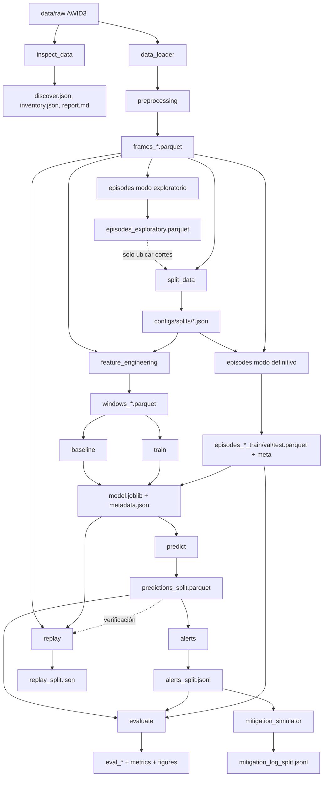

# Plan de implementación del código

**Proyecto:** Detección temprana de ataques de desautenticación y disociación en una red Wi-Fi para pequeña empresa mediante aprendizaje automático (prueba de concepto).
**Autor:** Juan David Quiroga — Universidad Distrital Francisco José de Caldas
**Fuente de verdad:** versión más reciente del paper (secciones III–VII) y plan de diseño e implementación integrado.
**Versión del plan:** 5. Los cambios respecto a las versiones anteriores están en la sección 15.
**Recursos confirmados:** equipo con 16 GB de RAM y aproximadamente 500 GB de espacio disponible. La primera implementación usará AWID3 en CSV; PCAP/tshark quedan como contingencia. La entrega de red inicial será la topología y su diagrama editable, no una simulación funcional de ataques.
**Estado:** plan de trabajo. Define carpetas, archivos, contratos de datos, relaciones entre módulos, orden de trabajo y criterios de salida. El código de `src/` implementa este plan; si ambos difieren, se corrige primero este documento.

---

## 0. Cómo usar este documento

1. Se implementa **por fases** (sección 11). Cada fase termina en un *criterio de salida* verificable; no se pasa a la siguiente sin cumplirlo.
2. Hay una **compuerta de decisiones (Gate D)** al final de la Fase 2: antes de entrenar cualquier modelo se congelan por escrito el caso de partición, `T`, `W`, `S`, las reglas de alertas, las características y las exclusiones. Nada de eso se cambia después de ver resultados de prueba.
3. Todo valor ajustable vive en archivos de configuración (`configs/`), no dentro del código. Un valor entre `< >` es una decisión pendiente: el código se niega a usarlo.
4. Los nombres de columnas de AWID3 que aparecen aquí son **hipótesis** que la Fase 1 debe confirmar. El código nunca los escribe a mano: los lee de `configs/data.yaml`.
5. **No se construyen abstracciones sobre columnas hipotéticas.** Todo el análisis trabaja sobre el formato interno propio del proyecto (sección 5.1), que no depende de AWID3. Solo `data_loader.py`, `preprocessing.py` e `inspect_data.py` tocan los nombres de AWID3, y lo hacen a través de la configuración.

---

## 1. Reglas que el código debe respetar siempre

| # | Regla | Dónde se hace cumplir |
|---|---|---|
| R1 | **Datos crudos inmutables.** `data/raw/` nunca se modifica; toda transformación escribe en `interim/` o `processed/`. | `data_loader.py`, `.gitignore` |
| R2 | **Sin etiquetas en la inferencia.** Las características se eligen con una lista explícita permitida (`features.yaml`). La etiqueta, el tipo de ataque, el episodio y cualquier campo de referencia nunca entran en `X`. | `feature_engineering.py`, `predict.py`, `test_no_label_leak.py` |
| R3 | **Causalidad.** Una ventana `[t_fin − W, t_fin)` solo usa tramas de ese intervalo y, como mucho, la ventana anterior. Nada de ventanas centradas ni estadísticas del futuro. | `feature_engineering.py`, `test_windows.py` |
| R4 | **La alerta ocurre al cierre de la ventana.** El instante de alerta es `t_fin`. | `evaluate.py`, `alerts.py` |
| R5 | **k = 1 fijo.** Una ventana es de ataque (etiqueta de referencia) si contiene al menos una trama del evento. `k` no se optimiza. | `config.py`, `feature_engineering.py`, `test_labels.py` |
| R6 | **Prueba una sola vez.** El conjunto de prueba no se usa para elegir umbral, hiperparámetros, `W`, `S`, `T`, reglas de alerta ni características. Solo se toca con `--final` y cada etapa final queda bloqueada si ya existe (sección 10). | `experiment.py`, `test_experiment.py` |
| R7 | **Partición sin fuga.** Ninguna ventana cruza una frontera entre conjuntos; la franja de purga alrededor de cada corte es **mayor o igual que `W`** y que la mayor `W` de sensibilidad. | `split_data.py`, `feature_engineering.py`, `test_split.py` |
| R8 | **Mismo cálculo en lote y en reproducción.** Una sola función (`compute_window_features`) calcula las características. La reproducción carga todas las decisiones de `metadata.json` y no reconstruye nada por su cuenta. | `feature_engineering.py`, `replay.py`, `test_replay_consistency.py` |
| R9 | **Sin acciones de red.** Ningún módulo envía tramas, abre sockets hacia equipos ni ejecuta comandos de red. La mitigación solo escribe registros. | revisión de código, `mitigation_simulator.py` |
| R10 | **Todo resultado es trazable.** Cada ejecución guarda configuración, commit, semilla, datos usados y entorno. | `experiment.py` |
| R11 | **El detector no afirma el tipo de ataque.** El modelo principal es binario; ningún archivo producido por el detector declara si la alerta es desautenticación o disociación. El tipo solo aparece en archivos de evaluación, tomado de la etiqueta de referencia. Los identificadores de captura son neutros (`cap_a`, `cap_b`). | `alerts.py`, `evaluate.py`, `test_alerts.py` |

---

## 2. Entorno

- **Sistema:** se confirmará en la Fase 0; el desarrollo inicial se documentará con el sistema que use el autor.
- **Editor:** VS Code.
- **Python:** versión instalada en el equipo del autor; se registra con `python3 --version` y en cada `run_*.json`.
- **Recursos confirmados:** 16 GB de RAM y aproximadamente 500 GB de espacio disponible. El procesamiento se hará por bloques y por captura; no se pretende ocupar todo el disco.
- **Datos iniciales:** AWID3 en CSV. Los archivos PCAP solo se usarán si el CSV no contiene un campo indispensable y los PCAP están disponibles.
- **Red:** se documentará la topología de referencia y se entregará un diagrama editable. No se implementará una simulación funcional de ataques 802.11 ni una red física.
- **Dependencias principales** (las declaradas en el paper): `pandas`, `numpy`, `scikit-learn`, `matplotlib`.
- **Dependencias auxiliares** (no cambian el método; se mencionan en el `README` y, si corresponde, en la sección de implementación del paper):
  - `pyarrow`: lectura y escritura en Parquet.
  - `pyyaml`: archivos de configuración.
  - `pytest`: pruebas automáticas.
  - `joblib`: guardado del modelo.
- **Herramienta condicional:** `tshark`, solo si el CSV no trae algún campo necesario y el PCAP está disponible.

### 2.1 Versiones fijadas

`requirements.txt` contiene **versiones exactas de referencia** y se verificó con la batería de pruebas. En la Fase 0 se crea el entorno en el equipo de desarrollo; si la versión de Python instalada requiere otras versiones compatibles, se regenera el archivo con `pip freeze` filtrado a estas ocho librerías y se vuelven a correr las pruebas. `run_*.json` registra las versiones y el hash de `requirements.txt` en cada ejecución (sección 10).

Instalación (en el `README.md`):

```bash
python3 -m venv .venv
source .venv/bin/activate
pip install -r requirements.txt
```

---

## 3. Estructura de carpetas

```text
wifi-early-detection-poc/
├── README.md                     # instalación, obtención de datos, cómo correr cada fase
├── CLAUDE.md                     # reglas R1–R11 para el asistente de código (ver nota 3.1)
├── plan-implementacion-codigo.md # este documento
├── requirements.txt              # versiones exactas
├── pytest.ini                    # configuración de pytest
├── .gitignore                    # data/, models/, results/ (salvo .gitkeep), .venv/, sal
│
├── configs/
│   ├── data.yaml                 # rutas, capturas, mapeo de columnas AWID3, etiquetas
│   ├── features.yaml             # lista permitida y exclusiones del Caso C
│   ├── splits/                   # particiones congeladas (Fase 2, se versionan)
│   └── experiments/
│       ├── exp_baseline.yaml               # línea base principal
│       ├── exp_rf.yaml                     # Random Forest principal (define la partición)
│       ├── exp_rf_sens_W_template.yaml     # plantilla: un archivo por cada W de sensibilidad
│       ├── exp_loao_deauth_to_disas.yaml   # Caso C, un sentido
│       └── exp_loao_disas_to_deauth.yaml   # Caso C, sentido inverso
│
├── docs/
│   ├── arquitectura.md
│   ├── diagramas/                 # diagramas editables y exportaciones para el paper
│   │   ├── README.md
│   │   └── arquitectura.mmd
│   ├── modelo-amenazas.md
│   ├── datos-awid3.md            # respuestas a las 14 preguntas de exploración (Fase 1)
│   ├── protocolo-evaluacion.md   # definiciones exactas de métricas (sección 8.7)
│   └── decisiones.md             # registro de decisiones congeladas (Gate D)
│
├── data/                         # NO se sube (salvo data/README.md y .gitkeep)
│   ├── README.md
│   ├── raw/                      # AWID3 tal como se descarga
│   ├── interim/                  # tramas normalizadas y episodios (Parquet)
│   └── processed/                # ventanas con características (Parquet)
│
├── notebooks/
│   └── exploracion_awid3.ipynb   # solo exploración y figuras
│
├── src/
│   ├── __init__.py
│   ├── config.py                 # carga y validación de YAML; rechaza valores < >
│   ├── experiment.py             # exp_id, run_*.json, metadatos, bloqueo de la prueba
│   ├── detectors.py              # clases guardadas con joblib (línea base y RF)
│   ├── inspect_data.py
│   ├── data_loader.py
│   ├── preprocessing.py
│   ├── episodes.py               # modos exploratorio y definitivo
│   ├── feature_engineering.py    # rejilla, compute_window_features, etiqueta k = 1
│   ├── split_data.py
│   ├── baseline.py
│   ├── train.py
│   ├── predict.py
│   ├── alerts.py
│   ├── evaluate.py
│   ├── replay.py
│   └── mitigation_simulator.py
│
├── tests/
│   ├── conftest.py               # datos sintéticos en formato interno
│   ├── test_episodes.py
│   ├── test_windows.py
│   ├── test_labels.py
│   ├── test_no_label_leak.py
│   ├── test_split.py
│   ├── test_evaluate.py
│   ├── test_alerts.py
│   ├── test_metadata.py
│   ├── test_replay_consistency.py
│   ├── test_mitigation.py
│   ├── test_experiment.py
│   ├── test_data_loader.py       # se escribe después de la Fase 1
│   └── test_preprocessing.py     # se escribe después de la Fase 1
│
├── models/                       # NO se sube
└── results/                      # NO se sube salvo resúmenes elegidos
```

### 3.1 Nota sobre `CLAUDE.md`

Se conserva porque el desarrollo se hará con Claude Code en VS Code. Si en algún momento se usa otra herramienta (por ejemplo Kiro), el mismo contenido se renombra a `AGENTS.md`. Si no se usa ningún asistente, las reglas pasan a una sección del `README.md`.

---

## 4. Configuración

### 4.1 `configs/data.yaml`

Los valores entre `< >` se completan en la Fase 1.

```yaml
paths:
  raw: data/raw
  interim: data/interim
  processed: data/processed

# Identificadores NEUTROS (R11): el tipo sale de la etiqueta de cada trama.
captures:
  - id: cap_a
    pattern: "<carpeta_captura_a>/*.csv"
  - id: cap_b
    pattern: "<carpeta_captura_b>/*.csv"

# Nombre interno -> nombre en AWID3 (hipótesis a confirmar en la Fase 1).
# Si AWID3 trae wlan.fc.type_subtype, se mapea fc_type_subtype en lugar de fc_type/fc_subtype.
columns:
  ts: frame.time_epoch
  frame_number: frame.number
  fc_type: wlan.fc.type
  fc_subtype: wlan.fc.subtype
  src: wlan.sa
  dst: wlan.da
  bssid: wlan.bssid
  reason_code: wlan.fixed.reason_code
  seq: wlan.seq
  signal_dbm: radiotap.dbm_antsignal
  protected: wlan.fc.protected
  mfpc: wlan.rsn.capabilities.mfpc
  mfpr: wlan.rsn.capabilities.mfpr
  label: Label

labels:
  target:                       # tipo_de_ataque -> valor exacto de la etiqueta
    deauth: "<etiqueta_deauth>"
    disas: "<etiqueta_disas>"
  normal: ["<etiqueta_normal>"]

anonymization:
  salt_env_var: WIFI_ML_SALT

read:
  chunksize: 200000             # ajustar según la RAM (P1)
```

Las tramas cuya etiqueta no está ni en `target` ni en `normal` quedan con `attack_type = other` e `is_target = False`, y se cuentan en `preprocessing_summary.json`. Su tratamiento se decide en Gate D (sección 7.4).

### 4.2 `configs/features.yaml`

```yaml
allowed:
  - n_frames_total
  - n_mgmt
  - n_data
  - ratio_data_mgmt
  - n_deauth
  - n_disas
  - n_disconn
  - rate_disconn
  - n_unique_src_disconn
  - n_unique_dst_disconn
  - frac_broadcast_dst_disconn
  - iat_disconn_mean
  - iat_disconn_std
  - iat_disconn_min
  - delta_n_disconn
  - frac_protected_mgmt
  - rc_counts            # se expande en rc_<código> para la lista fija, más rc_other
  - seq_jump_max         # solo si wlan.seq existe
  - signal_std_disconn   # solo si la señal existe

loao_exclude:
  - n_deauth
  - n_disas
  - rc_counts            # o solo los códigos que la Fase 1 identifique como sustitutos

reason_codes: ["<lista fija decidida en Gate D>"]
```

### 4.3 `configs/experiments/exp_rf.yaml` (principal)

```yaml
name: rf_main
role: main                      # main | sensitivity
seed: 42
data_config: configs/data.yaml
features_config: configs/features.yaml
split_file: configs/splits/caso_B.json

target: binary                  # DECIDIDO: normal vs. ataque de desconexión

window:
  W_seconds: <Gate D, desde estadísticas de entrenamiento (sección 8.2.1)>
  S_seconds: <Gate D, por resolución y costo (sección 8.2.1)>
  k: 1                          # fijo

split:                          # solo el experimento principal congela la partición
  case: B                       # A | B | C
  purge_seconds: <Gate D, >= W y >= max_W_seconds>
  max_W_seconds: <mayor W de los experimentos de sensibilidad>
  proportions: [0.6, 0.2, 0.2]
  snap_to_silence: true

episodes:
  T_method: percentile_multiple # fixed | percentile_multiple
  T_percentile: <Gate D>
  T_multiplier: <Gate D>        # T = multiplicador × percentil de intervalos entre tramas objetivo de entrenamiento

alerts:
  max_gap_seconds: <Gate D, mínimo S>

model:
  type: random_forest
  grid:
    n_estimators: [100, 300]
    max_depth: [null, 10, 20]
    min_samples_leaf: [1, 5]
  class_weight: balanced

imputation:
  strategy: constant            # constant | train_median, ajustada solo con entrenamiento
  value: -1

threshold:
  criterion: max_f1_validation

features_profile: allowed       # o loao

mitigation:                     # no afecta ninguna métrica de detección
  tau_high: <valor>
  cooldown_seconds: <valor>
```

### 4.4 Experimentos de sensibilidad

**Cada configuración alternativa de `W` es un experimento independiente**, con su propio archivo (`exp_rf_sens_W<valor>.yaml`, a partir de la plantilla), su propio `exp_id`, sus propias ventanas, su propio modelo, su propio `metadata.json` y sus propias métricas de validación. Comparte con el principal la partición, `S`, `T`, la rejilla de hiperparámetros, el entrenamiento y la validación.

- Llevan `role: sensitivity`. El código rechaza `--final` para ellos: nunca se ejecutan sobre la prueba.
- No reutilizan el modelo entrenado con la configuración principal.
- Sus resultados no pueden cambiar la configuración principal.
- La lista de valores de `W` se declara antes de Gate D en `docs/decisiones.md`, y la mayor se escribe en `split.max_W_seconds` para que la purga la cubra.
- En esta primera versión solo se analiza la sensibilidad de `W`. `k` está fijo, `T` se fija con entrenamiento, `S` se fija por resolución y costo, y no se amplía la rejilla de hiperparámetros ni la lista de códigos de motivo.

---

## 5. Contratos de datos

Cada artefacto tiene un esquema fijo. Si un módulo cambia su salida, se actualiza aquí primero.

### 5.1 Tramas normalizadas — `data/interim/frames_<capture>.parquet`

Este es el **formato interno** del proyecto. Las pruebas sintéticas trabajan sobre él.

| Columna | Tipo | Notas |
|---|---|---|
| `ts` | float64 | segundos (época) |
| `capture_id` | str | identificador neutro (`cap_a`, `cap_b`, …) |
| `file_idx` | int | orden del archivo dentro de la captura (orden natural de nombres) |
| `frame_number` | Int64 | número original |
| `fc_type` | Int16 | 0 gestión, 1 control, 2 datos |
| `fc_subtype` | Int16 | 10 disociación, 12 desautenticación, … |
| `src_anon`, `dst_anon`, `bssid_anon` | str | HMAC-SHA256 truncado a 12 caracteres; `BROADCAST` se conserva |
| `is_broadcast_dst` | bool | |
| `reason_code` | Int16 | nulo si no aplica |
| `seq` | Int16 | nulo si no existe |
| `signal_dbm` | float32 | nulo si no existe |
| `protected`, `mfpc`, `mfpr` | boolean | nulos si no existen |
| `label_raw` | str | etiqueta original (referencia) |
| `is_target` | bool | trama del evento de interés (referencia) |
| `attack_type` | str | `deauth`, `disas`, `normal` u `other` (referencia) |

### 5.2 Episodios

Hay **dos productos distintos**, que nunca se mezclan.

**a) Exploratorios — `data/interim/episodes_exploratory.parquet`** (más un resumen `.json` con percentiles de intervalos y los mayores silencios)

- Se calculan en la Fase 1 sobre toda la captura con un `T` provisional.
- Sirven **solo** para describir la estructura del dataset y para ubicar los cortes de la partición (sección 8.1).
- **Prohibido** usarlos para métricas, entrenamiento o etiquetado. `evaluate.py` solo acepta episodios con `mode = definitive`.

**b) Definitivos — `data/interim/episodes_<partición>_<split>.parquet`** (`train`, `val`, `test`) y `episodes_<partición>_meta.json`

| Columna | Notas |
|---|---|
| `episode_id` | `<capture>_<split>_<n>` |
| `mode` | `definitive` |
| `split` | `train`, `val` o `test` |
| `capture_id`, `attack_type` | tipo dominante de las tramas objetivo del episodio |
| `t_start`, `t_end` | primera y última trama objetivo dentro del conjunto |
| `n_frames` | tramas objetivo del episodio |
| `start_complete` | `True` si la trama objetivo anterior de la captura completa está a más de `T` (o no existe): el inicio real no fue recortado por un corte ni una purga |
| `T_seconds` | valor de `T` usado |

`episodes_<partición>_meta.json` guarda `T`, su método, el hash de la partición, los conteos por conjunto y **`latency_measurable_in_test`**. Si ya existen episodios definitivos con otro `T` u otra partición, el código se niega a sobrescribirlos.

### 5.3 Ventanas — `data/processed/windows_<partición>_W{W}_S{S}.parquet`

| Columna | Notas |
|---|---|
| `capture_id`, `window_id` | `window_id = j`, índice en la rejilla |
| `t_start`, `t_end` | `t_end = g0 + j·S` es el instante de alerta (R4) |
| `grid_origin` | `g0`: marca de tiempo de la primera trama de la captura |
| características | todas las de la sección 8.3; `X` usa solo las de `features.yaml` |
| `y`, `n_target` | etiqueta de referencia con k = 1 (R5) y número de tramas objetivo |
| `ref_<tipo>` | la ventana contiene tramas objetivo de ese tipo (referencia, solo evaluación) |
| `split` | `train`, `val`, `test` o `purged`, leído de la partición congelada |

- La rejilla es **completa**: hay una ventana cada `S` segundos, tenga o no tramas. La primera ventana completa termina en `g0 + W` y la última es la primera que termina después de la última trama.
- Ventana vacía: conteos y tasas en 0; fracciones, intervalos, `seq_jump_max` y `signal_std_disconn` nulos (imputados luego con el valor de entrenamiento); `y = 0`.
- **Ventana vacía normal → se evalúa. Ventana purgada → se excluye** de entrenamiento y evaluación.
- `feature_engineering.py` se niega a construir ventanas si `purge_seconds < W`, y si algún conjunto queda sin ventanas normales o sin ventanas de ataque.

### 5.4 Partición congelada — `configs/splits/<caso>.json`

```json
{
  "case": "B",
  "created_at": "<fecha>",
  "git_commit": "<hash>",
  "W_seconds": "<valor congelado en Gate D>",
  "S_seconds": "<valor>",
  "purge_seconds": "<valor >= max_W_seconds>",
  "max_W_seconds": "<mayor W entre el principal y la sensibilidad>",
  "cut_placement": "<regla usada para ubicar cada corte>",
  "label_aware": true,
  "label_aware_note": "<declaración de la limitación>",
  "units": {
    "train": [{"capture_id": "cap_a", "t_from": null, "t_to": "<t>"}],
    "val":   [{"capture_id": "cap_a", "t_from": "<t>", "t_to": "<t>"}],
    "test":  [{"capture_id": "cap_a", "t_from": "<t>", "t_to": null}]
  },
  "class_presence": {
    "train": {"n_windows": 0, "normal": true, "attack": true, "deauth": true, "disas": true},
    "val":   {"n_windows": 0, "normal": true, "attack": true, "deauth": true, "disas": false},
    "test":  {"n_windows": 0, "normal": true, "attack": true, "deauth": false, "disas": true}
  },
  "latency_measurable_in_test": "se determina con los episodios definitivos"
}
```

- Las unidades son intervalos semiabiertos `[t_from, t_to)`; `null` significa abierto. Una ventana pertenece a un conjunto solo si cabe completa en una de sus unidades.
- `split_data.py` rechaza congelar si `purge_seconds < max(W, max_W_seconds)`, si algún conjunto no tiene ventanas normales y de ataque, o si el archivo ya existe.

### 5.5 Contrato de `models/<exp_id>/metadata.json`

Contiene **todo** lo necesario para que `predict.py` y `replay.py` reproduzcan exactamente el cálculo en lote (R8). Ninguno de los dos usa `features.yaml` ni los parámetros del experimento para calcular; la configuración del experimento solo sirve para ubicar el `exp_id`.

| Campo | Contenido |
|---|---|
| `exp_id`, `role`, `git_commit`, `seed` | trazabilidad |
| `target` | `binary` |
| `model_type`, `model_params` | `threshold` o `random_forest`; hiperparámetros elegidos en validación |
| `feature_profile` | `baseline`, `allowed` o `loao` |
| `feature_columns` | lista **ordenada** de columnas de `X` |
| `reason_codes` | lista fija de códigos con columna propia |
| `imputation` | valor por columna, ajustado solo con entrenamiento |
| `categorical_encoding` | codificaciones usadas (vacío: no hay categóricas) |
| `W_seconds`, `S_seconds`, `k` | parámetros de ventana |
| `T_seconds` | umbral de silencio de episodios |
| `alerts.max_gap_seconds` | regla de fusión de alertas |
| `threshold` | umbral de decisión sobre la puntuación |
| `grid_origins` | `g0` de cada captura |
| `split_file`, `split_sha256` | partición usada y su hash |
| `windows_file` | ventanas usadas |
| `data_files_sha256` | hash de las tramas y de las ventanas de entrada |
| `library_versions`, `python_version` | entorno |
| `created_at` | fecha |
| `selection` | criterio, desempate y resultados de la búsqueda en validación |

`save_metadata` se niega a guardar si falta un campo, y en ese caso tampoco se guarda el modelo. `predict.py` falla con un error claro si falta un campo o si el hash de las ventanas no coincide.

### 5.6 Resultados — `results/<exp_id>/`

Los archivos llevan el conjunto como sufijo (`_val`, `_test`).

**Producidos por el detector** (no contienen información de referencia, R11):

| Archivo | Contenido |
|---|---|
| `predictions_<split>.parquet` | `capture_id, window_id, t_end, score, y_pred` |
| `alerts_<split>.jsonl` | **todos** los eventos de alerta: `alert_id, capture_id, t_alert, t_last, n_windows, max_score` |
| `mitigation_log_<split>.jsonl` | una línea por **notificación** simulada (ver abajo) |
| `replay_<split>.json`, `replay_predictions_<split>.parquet` | tiempos, latencia de procesamiento, tasas y verificación contra el lote |

Contrato de cada notificación de `mitigation_log_<split>.jsonl`:

```json
{
  "notification_id": "notif_00004",
  "alert_id": "alert_00010",
  "source_alert_ids": ["alert_00010", "alert_00011", "alert_00012"],
  "capture_id": "cap_a",
  "hora_de_alerta": 0.0,
  "tipo_de_evento": "ataque_de_desconexion",
  "confianza": 0.97,
  "prioridad": "alta",
  "accion_simulada": [{"accion": "notificar_administrador", "estado": "simulada"},
                      {"accion": "cambio_de_canal", "estado": "solo_diseno"}],
  "clientes": {"compatibles": [], "no_compatibles": [], "compatibilidad_desconocida": []},
  "latencia_de_respuesta": 0.0,
  "resultado": "registrado"
}
```

`alert_id` es la alerta que abrió la notificación; `source_alert_ids` lista todas las alertas que absorbió por el enfriamiento. Las tres siguen existiendo en `alerts_<split>.jsonl`: el enfriamiento no elimina alertas.

**Producidos por la evaluación** (cruzan con las etiquetas de referencia):

| Archivo | Contenido |
|---|---|
| `eval_windows_<split>.parquet` | predicciones + `y` + `ref_<tipo>` |
| `eval_alerts_<split>.jsonl` | cada alerta + `matched_episode_id` + `attack_type_ref` + `is_false_alert` |
| `metrics_window_<split>.json` | matriz de confusión, precisión, exhaustividad, F1, FPR, FNR; global y por tipo cuando el tipo está presente |
| `metrics_episode_<split>.json` | por episodio: detectado, latencia, tramas antes de la alerta; agregados global y por tipo; falsas alertas por hora |
| `figures/` | curva PR y línea temporal de puntuaciones con los episodios sombreados |
| `permutation_importance_val.json` | opcional, solo validación |
| `run_<etapa>[_<split>].json` | registro de cada ejecución (sección 10) |

---

## 6. Módulos: responsabilidades y relaciones

| Módulo | Responsabilidad | Lee | Escribe | Depende de |
|---|---|---|---|---|
| `config.py` | Cargar YAML, validar claves, rechazar valores `< >`, `target = binary`, `k = 1`, `S < W` y `W` múltiplo de `S` | `configs/*.yaml` | — | — |
| `experiment.py` | `exp_id`, carpeta de resultados, `run_*.json`, contrato de metadatos, bloqueo de la prueba | — | `results/_index/`, `results/<exp_id>/run_*.json` | `config` |
| `detectors.py` | Clases guardadas con joblib | — | — | — |
| `inspect_data.py` | Descubrimiento de archivos y columnas; inventario e informe por captura | `data/raw` | `results/inspection/*` | `config`, `data_loader` |
| `data_loader.py` | Lectura por bloques de las columnas mapeadas, como texto | `data/raw` | iterador de bloques | `config` |
| `preprocessing.py` | Tipos, limpieza, orden, anonimización, campos de referencia | bloques | `frames_*.parquet`, `preprocessing_summary.json` | `data_loader` |
| `episodes.py` | Modo exploratorio (`T` provisional) y modo definitivo (`T` de entrenamiento, `start_complete`) | `frames_*`, partición | `episodes_*.parquet`, `*_meta.json` | `feature_engineering` |
| `split_data.py` | Casos A/B/C, purga, presencia de clases con la misma rejilla del lote, congelamiento | `frames_*`, `episodes_exploratory` (solo cortes) | `configs/splits/*.json` | `episodes`, `feature_engineering` |
| `feature_engineering.py` | Rejilla completa, `compute_window_features`, `y` con k = 1, `ref_<tipo>`, marca de conjunto | `frames_*`, `configs/splits/<caso>.json` | `windows_*.parquet` | `preprocessing`, partición |
| `baseline.py` | Umbral sobre `n_disconn` elegido en validación | ventanas | `model.joblib`, `metadata.json` | `predict`, `detectors` |
| `train.py` | Random Forest, búsqueda y umbral en validación | ventanas | `model.joblib`, `metadata.json` | `baseline`, `predict`, `detectors` |
| `predict.py` | Imputación, `X` y predicción usando solo `metadata.json` | modelo, metadatos, ventanas | `predictions_<split>.parquet` | `detectors` |
| `alerts.py` | Fusionar ventanas positivas con `max_gap_seconds` | predicciones, metadatos | `alerts_<split>.jsonl` | `predict` |
| `evaluate.py` | Métricas por ventana y episodio, cruce con referencia | predicciones, alertas, ventanas, episodios definitivos, tramas | `eval_*`, `metrics_*`, `figures/` | `alerts`, `episodes` |
| `replay.py` | Reproducción temporal con los metadatos guardados y verificación contra el lote | tramas, modelo, metadatos, partición | `replay_*` | `feature_engineering`, `predict` |
| `mitigation_simulator.py` | Política simulada; el enfriamiento agrupa notificaciones, nunca elimina alertas | `alerts_<split>.jsonl`, tramas (`mfpc`) | `mitigation_log_<split>.jsonl` | `alerts` |

### 6.1 Flujo entre módulos



### 6.2 Cómo se ejecuta cada paso

```bash
export WIFI_ML_SALT='<sal secreta, fuera del repositorio>'

# Fase 1
python -m src.inspect_data         --data configs/data.yaml --discover
python -m src.inspect_data         --data configs/data.yaml [--max-rows N]
python -m src.preprocessing        --data configs/data.yaml [--max-rows N]
python -m src.episodes             --mode exploratory --data configs/data.yaml --T-provisional <s>

# Fase 2 (Gate D)
python -m src.split_data           --exp configs/experiments/exp_rf.yaml            # vista previa
python -m src.split_data           --exp configs/experiments/exp_rf.yaml --freeze
python -m src.episodes             --mode definitive --exp configs/experiments/exp_rf.yaml
python -m src.feature_engineering  --exp configs/experiments/exp_rf.yaml

# Fases 3 y 4 (solo validación)
python -m src.baseline             --exp configs/experiments/exp_baseline.yaml
python -m src.train                --exp configs/experiments/exp_rf.yaml [--importance]
python -m src.predict              --exp configs/experiments/exp_rf.yaml --split val
python -m src.alerts               --exp configs/experiments/exp_rf.yaml --split val
python -m src.evaluate             --exp configs/experiments/exp_rf.yaml --split val --figures

# Fase 5 (una sola vez, con el árbol git limpio)
python -m src.predict              --exp configs/experiments/exp_rf.yaml --split test --final
python -m src.alerts               --exp configs/experiments/exp_rf.yaml --split test --final
python -m src.evaluate             --exp configs/experiments/exp_rf.yaml --split test --final --figures

# Fase 6
python -m src.replay               --exp configs/experiments/exp_rf.yaml --split test --final [--speed max|1.0]
python -m src.mitigation_simulator --exp configs/experiments/exp_rf.yaml --split test --final
```

`--final` es la única forma de tocar el conjunto de prueba (R6). Cada etapa final (`predict`, `alerts`, `evaluate`, `replay`, `mitigation`) solo puede ejecutarse una vez por experimento.

---

## 7. Datos: lectura y preprocesamiento

### 7.1 Lectura por bloques

- Leer **solo** las columnas mapeadas, como texto, por bloques de `read.chunksize` filas.
- Respetar el orden de archivos de cada captura (orden natural del nombre). Hipótesis a confirmar: los CSV de un mismo ataque son tramos consecutivos de una sola captura.
- Errores comprensibles si un patrón sigue pendiente, si no hay archivos o si falta una columna obligatoria (`ts`, `label`, subtipo).
- Convertir cada captura a Parquet una sola vez; el resto del flujo trabaja sobre Parquet.

### 7.2 Limpieza

- Enteros aceptan decimal, `12.0` y hexadecimal `0x..`; booleanos aceptan `1/0`, `true/false`. Los valores no convertibles pasan a nulo y se cuentan por columna.
- Filas sin `ts` y duplicados exactos se eliminan y se cuentan.
- Orden estable por `ts`, `file_idx` y `frame_number`; se reportan las inversiones encontradas.

### 7.3 Anonimización

- MAC → `HMAC-SHA256(sal, mac)` truncado a 12 caracteres; la sal se lee de la variable de entorno configurada.
- `ff:ff:ff:ff:ff:ff` se conserva como `BROADCAST`.
- Las MAC originales no salen de `data/raw/`.

### 7.4 Precaución con otras capturas y etiquetas de AWID3

Es posible que otras capturas contengan tramas de desautenticación etiquetadas como parte de otro ataque. El estudio principal se limita a las capturas de desautenticación y disociación. Las tramas con etiquetas ajenas (`attack_type = other`) se cuentan; usarlas como tráfico normal o excluirlas se decide en Gate D y queda en `docs/decisiones.md`.

---

## 8. Detalles algorítmicos clave

### 8.1 Episodios: exploratorios frente a definitivos

**Paso 1 — Exploración (Fase 1)**
1. Sobre toda la captura, agrupar las tramas objetivo con un `T` provisional.
2. Elegir el `T` provisional de forma descriptiva con el resumen de intervalos que genera el script y registrarlo en `docs/datos-awid3.md`.
3. Uso permitido: describir el dataset, responder si hay una o varias ráfagas y ubicar cortes.

**Paso 2 — Partición (Fase 2)**
1. `split_data.py` usa los episodios exploratorios **solo para ubicar los cortes** en silencios entre ráfagas donde quepa la purga.
2. La partición usa la **posición** de las etiquetas, pero **nunca** resultados de ningún modelo.

**Paso 3 — Episodios definitivos (Fase 2, después de congelar la partición)**
1. Calcular `T` **solo** con las tramas objetivo del entrenamiento: `fixed` (argumento de dominio escrito antes) o `percentile_multiple` (`T = multiplicador × percentil` de los intervalos entre tramas objetivo de entrenamiento).
2. Aplicar ese mismo `T` a los tres conjuntos.
3. Recortar cada episodio a su unidad y marcar `start_complete`.

### 8.2 Ventanas (`feature_engineering.py`)

- Duración `W`, paso `S`, `S < W`, `W` múltiplo de `S`. Rejilla alineada a `g0`, la primera trama de la captura: `t_end_j = g0 + j·S` para `j ≥ W/S`.
- Rejilla **completa** sobre toda la captura, incluidas las ventanas sin tramas (sección 5.3).
- La asignación `train`/`val`/`test`/`purged` se lee de la partición congelada.
- Una sola función, `compute_window_features(tramas_de_la_ventana, n_disconn_anterior, W, reason_codes)`, calcula las características y recibe solo campos observables. El cálculo en lote obtiene las tramas de cada ventana con búsqueda binaria sobre las marcas de tiempo ordenadas; la reproducción, con un búfer que se desliza. Se prefirió esta forma a las sumas rodantes por intervalos para garantizar resultados idénticos en ambos caminos (R8); el costo es del orden de `W/S` veces el número de tramas.

#### 8.2.1 Selección de `W` y `S` (antes de Gate D, sin entrenar modelos)

La configuración principal se fija **antes de entrenar**, solo con estadísticas del conjunto de entrenamiento y requisitos de operación. No se elige mirando resultados de validación ni de prueba.

**`S` — resolución de la alerta.** Con la rejilla fija, alerta al cierre, k = 1 y rejilla completa, la primera ventana que contiene la primera trama del ataque cierra como máximo `S` segundos después de esa trama (salvo un ataque que empiece en los primeros `W` segundos de la captura, cuya primera ventana cierra en `g0 + W`). `S` se fija considerando la resolución deseada, las ventanas por segundo que implica, la capacidad de procesamiento y la relación con `W`.

**`W` — evidencia por ventana.** Se fija con datos de entrenamiento: frecuencia de tramas de gestión en tráfico normal, duración de los episodios de entrenamiento, tramas necesarias para que las características estén definidas (al menos dos desconexiones para los intervalos) y costo por ventana.

**Criterio reproducible** (en `docs/decisiones.md`, con los números de la Fase 1):

> Se selecciona la menor ventana que contiene suficiente información del tráfico de gestión normal del entrenamiento y permite calcular las características definidas, manteniendo `W` como múltiplo de `S`.

**Análisis de sensibilidad:**

> La configuración principal de `W` y `S` se fija antes de entrenar mediante estadísticas del conjunto de entrenamiento. Cada configuración alternativa de `W`, declarada antes de Gate D, es un experimento independiente (sección 4.4) que se evalúa **únicamente sobre validación**. Sus resultados no pueden cambiar la configuración principal, y ninguna configuración alternativa se ejecuta sobre la prueba, que se reserva para una única ejecución con la configuración principal.

### 8.3 Características (definiciones)

Todas usan las tramas de `[t_end − W, t_end)`, salvo `delta_*`, que usa además la ventana `j − 1`. "Desconexión" significa trama de gestión con subtipo 10 o 12.

| Característica | Definición | Sin desconexiones en la ventana |
|---|---|---|
| `n_frames_total`, `n_mgmt`, `n_data` | conteos por tipo | conteo (0 si vacía) |
| `ratio_data_mgmt` | `n_data / max(n_mgmt, 1)` | igual |
| `n_deauth`, `n_disas` | conteos por subtipo (12 y 10) | 0 |
| `n_disconn` | `n_deauth + n_disas` | 0 |
| `rate_disconn` | `n_disconn / W` | 0 |
| `n_unique_src_disconn`, `n_unique_dst_disconn` | identificadores distintos en desconexiones | 0 |
| `frac_broadcast_dst_disconn` | fracción de desconexiones con destino `BROADCAST` | nulo |
| `iat_disconn_mean/std/min` | intervalos entre desconexiones consecutivas | nulo (también con una sola) |
| `delta_n_disconn` | `n_disconn` actual menos el de la ventana anterior | nulo en la primera ventana |
| `frac_protected_mgmt` | fracción de tramas de gestión con `protected = 1` | nulo si no hay gestión |
| `rc_<código>`, `rc_other` | conteo por código de motivo en desconexiones; el resto va a `rc_other` | 0 |
| `seq_jump_max` | mayor salto circular de `seq` (módulo 4096) entre tramas de gestión consecutivas de una misma fuente que envió desconexiones | nulo |
| `signal_std_disconn` | desviación de la señal en desconexiones (al menos dos valores) | nulo |

`seq_jump_max` y `signal_std_disconn` son **características candidatas de diseño**; ninguna referencia aprobada demuestra que delaten por sí solas tramas de desconexión falsificadas. La imputación de nulos se ajusta solo con entrenamiento y se guarda en `metadata.json`. Random Forest no necesita normalización.

### 8.4 Partición (`split_data.py`) y presencia de clases

**Partición consciente de etiquetas (casos A, B y C):**

> La construcción de las particiones utiliza las etiquetas de referencia únicamente para organizar capturas, verificar la presencia de clases, ubicar cortes entre episodios y construir el *leave-one-attack-out*. Las etiquetas no se utilizan como características, para ajustar el modelo ni para modificar el conjunto de prueba después de observar resultados.

**Regla general de clases (todos los casos):**

1. **Obligatorio:** cada conjunto contiene ventanas normales (`y = 0`) y ventanas de ataque (`y = 1`). La presencia se calcula con la misma rejilla del lote.
2. **Se verifica por separado** la presencia de cada tipo de ataque, sin exigirla. Se registra en `class_presence`.
3. **Si un conjunto no tiene un tipo,** la métrica de ese tipo se reporta como "no disponible", nunca como cero.
4. **Si AWID3 no permite construir conjuntos con tráfico normal y ataque, la partición se rechaza.** Nunca se duplican, sobremuestrean ni sintetizan ataques para corregirla. El desbalance se trata solo con `class_weight` dentro del entrenamiento.

**Casos:**

- **Caso A (varias capturas independientes):** capturas completas a cada conjunto, por asignación explícita o con semilla. No requiere purga dentro de las capturas.
- **Caso B (una captura por ataque):** dos cortes por captura en los cuantiles de las tramas objetivo (por ejemplo 60/20/20); cada corte se mueve al centro del silencio entre ráfagas exploratorias más cercano en el que quepa la purga. Purga ≥ `max_W_seconds` a cada lado de cada corte. La latencia en prueba es medible solo si hay un episodio definitivo con `start_complete = True` en prueba.
- **Caso C (leave-one-attack-out):** entrenamiento y validación con las capturas de un tipo (validación = tramo final, con purga) y prueba con la captura completa del otro tipo, incluido su inicio. Perfil `loao`. Un archivo de experimento por sentido.

**Verificaciones antes de congelar:** unidades sin solapamiento; cada conjunto con `y = 0` e `y = 1`; `purge_seconds ≥ max(W, max_W_seconds)`; `class_presence` completo; archivo nuevo, con el commit actual.

### 8.5 Línea base (`baseline.py`)

- Regla: alerta si `n_disconn ≥ θ` (alternativa: `rate_disconn`).
- `θ` se elige en validación con máximo F1 por ventana. En caso de empate gana el menor `θ`.
- Guarda `model.joblib` y `metadata.json` con el mismo contrato, para que `predict.py`, `alerts.py` y `replay.py` la traten igual que a Random Forest.

### 8.6 Random Forest (`train.py`)

- Rejilla de hiperparámetros: cada combinación se entrena con entrenamiento y se evalúa **solo** en validación, con su mejor umbral. Gana el máximo F1; en empate, la primera de la rejilla. No se usa validación cruzada aleatoria.
- `class_weight: balanced`.
- El umbral sobre la probabilidad se elige en validación con el mismo criterio que la línea base.
- Guarda el `metadata.json` completo, incluida la tabla de la búsqueda.
- Importancia por permutación en validación con `average_precision` (opcional, `--importance`).

### 8.7 Alertas y métricas por episodio

**Fusión de alertas (`alerts.py`):**

- Ventana positiva: `score ≥ threshold`. Instante de alerta: `t_end`.
- Dos ventanas positivas `i` y `j` de la misma captura (con `j` posterior) pertenecen al **mismo evento** si `t_end(j) − t_end(i) ≤ max_gap_seconds`.
- `max_gap_seconds ≥ S`; con `max_gap_seconds = S` solo se fusionan ventanas consecutivas.
- El enfriamiento no pertenece a `alerts.py` y no afecta ninguna métrica.

**Métricas (`evaluate.py`, ver `docs/protocolo-evaluacion.md`):**

- **Episodio detectado:** existe al menos una ventana positiva que se solapa con `[t_start, t_end]` del episodio definitivo.
- **Latencia:** `t_end` de la primera ventana positiva solapada menos `t_start`. Solo si `start_complete = True`.
- **Tramas antes de la alerta:** tramas objetivo del episodio con `ts` menor que el instante de alerta.
- **Falsa alerta:** evento cuya cobertura `[t_alert − W, t_last)` no se solapa con ningún episodio definitivo del conjunto.
- **Falsas alertas por hora:** falsas alertas divididas entre las horas de tiempo normal evaluado (duración del conjunto sin purgas menos la duración de los episodios).
- **Un solo episodio:** valor individual, sin media ni mediana. **Sin inicio completo:** "no disponible para esta partición".
- **Por tipo de ataque:** solo donde el tipo está presente. Por ventana se usa el subconjunto de ventanas normales más las que contienen ese tipo. El tipo sale de la referencia, nunca del detector.

### 8.8 Reproducción temporal (`replay.py`)

- Carga el modelo y **todo** `metadata.json`. Usa la partición registrada para saber qué ventanas emitir.
- Recorre las tramas en orden de `ts`, desde la ventana anterior a la primera del conjunto (alimenta `delta_n_disconn`), manteniendo en un búfer solo las tramas de la ventana actual.
- Al cerrar cada ventana llama a `compute_window_features`, predice y registra tiempos con `time.perf_counter()`.
- Modos `--speed max` y `--speed <factor>` (1.0 = tiempo real de los datos).
- Compara ventana a ventana con `predictions_<split>.parquet` (mismo conjunto de ventanas, puntuación con tolerancia `1e-9` y misma decisión). Si alguna difiere, `consistency_with_batch.valid = false` y el resultado no se reporta.
- La latencia medida es de procesamiento (registro → característica → predicción); no es tiempo de reconexión ni eficacia de mitigación.

### 8.9 Mitigación simulada (`mitigation_simulator.py`)

| Condición | Acción simulada |
|---|---|
| Siempre | Registrar el evento y notificar al administrador (simulado) |
| `max_score ≥ tau_high` | Prioridad alta; recomendar PMF a los clientes compatibles |
| Clientes con `mfpc = 0` en (re)asociación | Listarlos (anonimizados) como **no compatibles con PMF** |
| Clientes con `mfpc` nulo | Listarlos como **compatibilidad desconocida**; nunca como vulnerables |
| Nueva alerta de la misma captura dentro de `cooldown_seconds` desde la notificación anterior | Se agrega a `source_alert_ids` de esa notificación; la alerta sigue en `alerts_<split>.jsonl` |
| Cambio de canal, localización aproximada por RSSI | Registrar como `solo_diseno`, sin ejecutar |

```text
mfpc = 0   → cliente identificado como no compatible con PMF
mfpc = 1   → cliente identificado como compatible con PMF
mfpc nulo  → compatibilidad desconocida (no se clasifica como vulnerable)
```

El estado de cada cliente se calcula solo con observaciones anteriores a la alerta. Si AWID3 no trae el campo, todos los clientes quedan como desconocidos y esa limitación se declara. **Nunca** se aísla una fuente por su MAC. `tipo_de_evento` siempre es `ataque_de_desconexion` (R11). `latencia_de_respuesta` es un dato del flujo, no una medida de eficacia.

---

## 9. Pruebas automáticas (`tests/`)

### 9.1 Tanda 1 — sobre el formato interno sintético (implementada)

`conftest.py` genera dos capturas sintéticas de 600 s en formato interno: balizas, tráfico de datos, asociaciones con `mfpc` verdadero, falso y nulo, una desautenticación legítima y cinco ráfagas de ataque por captura. Estas pruebas no dependen de AWID3.

| Archivo | Qué verifica |
|---|---|
| `test_episodes.py` | ráfagas con `T` conocido; `start_complete` al recortar; `T` solo con entrenamiento; rechazo de `T` distinto y de valores pendientes |
| `test_windows.py` | rejilla completa, ordenada y sin duplicados; una trama en `t_end` no entra y una en `t_end − W` sí (R3); tramas futuras no cambian ventanas pasadas; ventanas vacías con conteos en 0 e intervalos nulos; perfiles `allowed` y `loao`; rechazo de purga menor que `W` |
| `test_labels.py` | una sola trama objetivo produce `y = 1` en exactamente `W/S` ventanas; rechazo de `k ≠ 1` y de objetivo no binario |
| `test_no_label_leak.py` | `X` sin columnas de referencia; alterar etiquetas no cambia ninguna característica (R2) |
| `test_split.py` | unidades sin solapamiento y con purga; cada ventana en a lo sumo un conjunto; ambas clases en cada conjunto; cortes en silencios; rechazo por purga corta, por purga menor que la `W` de sensibilidad y por conjunto sin ataques; Caso C acepta un solo tipo en prueba |
| `test_evaluate.py` | latencia, tramas antes de la alerta, falsas alertas por hora, valor individual, media y mediana, "no disponible" y métricas por tipo, en casos calculados a mano |
| `test_alerts.py` | fusión con `max_gap_seconds`; alertas sin campos de tipo de ataque (R11) |
| `test_metadata.py` | cada campo obligatorio se reporta si falta; no se guarda un contrato incompleto; error claro sin metadatos; metadatos completos tras entrenar |
| `test_replay_consistency.py` | un búfer deslizante da las mismas características que el lote; reproducción igual al lote para RF y línea base; detección de una inconsistencia introducida a propósito |
| `test_mitigation.py` | el enfriamiento conserva las alertas y solo agrupa notificaciones; `source_alert_ids` cubre todas las alertas; `mfpc` nulo nunca es "no compatible"; observaciones causales; sin acciones de aislamiento |
| `test_experiment.py` | la prueba exige `--final`; la sensibilidad no llega a la prueba; una etapa final no se repite; un `exp_id` no se reutiliza; flujo completo en validación con `run_*.json` que incluye Python, plataforma y hash de `requirements.txt` |

### 9.2 Tanda 2 — después de la Fase 1

| Archivo | Qué verifica |
|---|---|
| `test_data_loader.py` | error comprensible si falta un archivo o una columna real; lectura por bloques correcta sobre una muestra pequeña real |
| `test_preprocessing.py` | conversión de los tipos reales; anonimización estable; `BROADCAST` preservado; ninguna MAC original en la salida |

Se agregan casos a la tanda 1 si la Fase 1 revela situaciones no contempladas (marcas de tiempo repetidas, campos nulos frecuentes, subtipos en otro formato).

Comando: `pytest -q`. Se corre antes de cada commit a `main`.

---

## 10. Registro de experimentos y bloqueo de la prueba

- `exp_id = AAAAMMDD-HHMM-<nombre>`. Lo crean `train` o `baseline` y queda en `results/_index/<nombre>.json`; las etapas siguientes lo leen de ahí. Un nombre de experimento no puede reutilizarse: repetir exige un experimento nuevo.
- Cada etapa escribe `results/<exp_id>/run_<etapa>[_<split>].json` con configuración completa, archivo de configuración, commit, estado del árbol, semilla, partición y su hash, fechas y el entorno:

```json
{
  "python_version": "3.12.x",
  "platform": "<sistema operativo, versión y arquitectura>",
  "library_versions": {"pandas": "...", "scikit-learn": "..."},
  "requirements_sha256": "<hash de requirements.txt>"
}
```

- **Ejecución final (`--final`):**
  - Solo con `role: main` y solo sobre la prueba.
  - Se niega a correr fuera de un repositorio git o con cambios sin guardar.
  - Se niega a correr si esa etapa ya tiene un resultado final para ese experimento (`results/<exp_id>/final/<etapa>.done`).
- `docs/decisiones.md` enlaza cada decisión congelada con su commit.

---

## 11. Fases de implementación

### Fase 0 — Preparación (~1 día)

- Repositorio, estructura, `.gitignore`, `README.md` y `CLAUDE.md`.
- Crear el entorno e instalar `requirements.txt`; regenerarlo si Python 3.12 resuelve otras versiones.
- Módulos sobre el formato interno y pruebas de la tanda 1.
- **Salida:** `pytest -q` en verde y entorno reproducible con el `README`.
- **Estado:** el código de esta fase y de los módulos de análisis ya está escrito y verificado con datos sintéticos; falta crear el entorno en el equipo de desarrollo y hacer el primer commit.

### Fase 1 — Inspección de AWID3 (semana 1)

- La fuente inicial será **CSV**. El PCAP no forma parte del flujo principal y solo se considera si el CSV no contiene un campo indispensable.
- `data_loader.py` (lectura por bloques), `inspect_data.py` y `data/README.md`.
- `inspect_data` por captura (primero con `--max-rows`), `preprocessing` y episodios exploratorios.
- Responder las 14 preguntas en `docs/datos-awid3.md` con evidencia.
- Escribir las pruebas de la tanda 2.
- **Salida:** informe generado por script, 14 preguntas respondidas y `data.yaml` sin valores `< >`.

### Fase 2 — Partición, episodios definitivos y ventanas (semana 2)

- **Gate D — decisiones congeladas** en `docs/decisiones.md`:
  - objetivo binario confirmado, con análisis por tipo como reporte adicional;
  - caso de partición (A, B o C), proporciones y regla de cortes;
  - `W` y `S` principales con el criterio de la sección 8.2.1 y la lista de `W` de sensibilidad;
  - `purge_seconds ≥ max(W, max_W_seconds)`;
  - método y parámetros de `T`;
  - `max_gap_seconds`;
  - lista fija de códigos de motivo, exclusiones del Caso C y características que se quitan por falta de campos;
  - tratamiento de las tramas `other`;
  - criterio de umbral;
  - `tau_high` y `cooldown_seconds`.
- `split_data --freeze`, luego `episodes --mode definitive`, luego `feature_engineering`.
- Commit y etiqueta `gate-d`.
- **Salida:** partición, episodios definitivos y ventanas congelados; pruebas en verde.

### Fase 3 — Línea base (semana 3)

- `baseline`, `predict`, `alerts` y `evaluate` sobre **validación**.
- **Salida:** métricas de la línea base en validación, con `metadata.json` y `run_*.json` completos.

### Fase 4 — Random Forest y sensibilidad (semana 4)

- `train` con búsqueda en validación e importancia por permutación.
- Un experimento independiente por cada `W` de sensibilidad, **solo sobre validación**.
- **Salida:** modelo recargable sin reentrenar, métricas comparables con la línea base y tabla de sensibilidad en validación.

### Fase 5 — Evaluación final (semana 5)

- `--final` para la línea base y Random Forest, **solo con la configuración principal**; Caso C en ambos sentidos si aplica.
- **Salida:** `metrics_window_test.json`, `metrics_episode_test.json` y figuras. La prueba no se vuelve a tocar.

### Fase 6 — Reproducción y mitigación (semana 6)

- `replay` (con la verificación contra las predicciones en lote) y `mitigation_simulator`.
- **Salida:** `replay_test.json` válido y `mitigation_log_test.jsonl`.

### Fase 7 — Revisión (semana 7)

- Revisar falsos positivos y negativos en la línea temporal.
- Tabla "afirmación del paper → archivo de evidencia".
- Actualizar limitaciones.

### Fase 8 — Documentación (semana 8)

- `README` final, tablas y figuras para el paper, limpieza.
- **Salida:** un tercero reproduce el experimento final siguiendo solo el `README`.

**Criterio de recorte:** si falta tiempo, se protegen las Fases 1 a 5 y la documentación. La Fase 6 se reduce a una mitigación mínima y la reproducción solo en modo `--speed max`.

---

## 12. Flujo de trabajo con Git

- Todos los commits, ramas y publicaciones los hace el autor desde su cuenta.
- `main` siempre con las pruebas en verde.
- Ramas por fase (`fase1-inspeccion`, `fase2-particion`, …), fusionadas al cumplir el criterio de salida.
- Commits cortos en presente: `feat(episodes): modo definitivo con T de entrenamiento`.
- Etiquetas: `gate-d` y `final-<exp_id>`.
- No se suben `data/`, `models/`, la mayoría de `results/` ni la sal. Sí se suben `configs/splits/*.json`, `docs/decisiones.md` y los resúmenes de métricas elegidos para el paper.

---

## 13. Riesgos y planes alternativos

| Riesgo | Señal | Plan |
|---|---|---|
| AWID3 no cabe en memoria | errores de memoria o lectura lenta | bajar `chunksize`, procesar una captura a la vez, usar `--max-rows` para explorar |
| Falta un campo (`wlan.seq`, señal, `mfpc`) | ausente en la Fase 1 | quitar la característica y registrarlo como limitación; `tshark` solo si hay pcap |
| Un solo episodio por ataque | ráfaga continua en la Fase 1 | Caso B para clasificación y Caso C para latencia; latencia descriptiva |
| Un conjunto queda sin un tipo de ataque | `class_presence` | se acepta; métricas de ese tipo "no disponibles" |
| Un conjunto queda sin ataques o sin normales | `split_data` lo rechaza | rediseñar cortes antes de Gate D; nunca sintetizar ataques |
| La línea base iguala o supera a Random Forest | métricas de validación | se reporta tal cual; el aporte es la evaluación de latencia y falsas alertas |
| F1 ≈ 1 sospechoso | validación | revisar fuga, purga y sustitutos de la etiqueta |
| La reproducción no coincide con el lote | `consistency_with_batch.valid = false` | revisar metadatos y la función compartida antes de reportar |
| Tiempo insuficiente | atraso de más de una semana | criterio de recorte |

### 13.1 Limitaciones que el código deja documentadas

- **Partición consciente de etiquetas:** las particiones se construyen con conocimiento de las etiquetas y de la distribución de los eventos. Aunque las etiquetas no ingresan al modelo, esto limita la interpretación de la generalización frente a una red no etiquetada.
- **Compatibilidad PMF desconocida:** si `mfpc` no está disponible o es nulo, la identificación de clientes no compatibles no es posible para esos clientes.
- **Resolución de la latencia:** la latencia medida está acotada por la rejilla de paso `S`; diferencias menores que `S` no son interpretables.
- **Transferencia limitada en el Caso C:** evalúa la transferencia entre dos ataques relacionados, no la generalización a ataques de otra naturaleza.

---

## 14. Decisiones tomadas y preguntas abiertas

### 14.1 Ya decidido

- **Objetivo binario** (normal frente a ataque de desconexión); desempeño por tipo como análisis adicional; Caso C con características agregadas.
- `W` y `S` principales se fijan antes de Gate D con estadísticas del entrenamiento; cada `W` de sensibilidad es un experimento independiente, solo en validación; la prueba se ejecuta una sola vez.
- Rejilla completa de ventanas, incluidas las vacías; las purgadas se excluyen.
- Partición consciente de etiquetas en los tres casos, declarada como limitación; si no hay conjuntos con normal y ataque, se rechaza.
- `alerts_<split>.jsonl` guarda todas las alertas; el enfriamiento solo agrupa notificaciones, con `notification_id` y `source_alert_ids`.
- `mfpc` nulo significa compatibilidad desconocida.
- Identificadores de captura neutros; el tipo de ataque sale de la etiqueta.
- Dependencias auxiliares: `pyarrow`, `pyyaml`, `pytest`, `joblib`. Asistente: Claude Code (`CLAUDE.md`).

### 14.2 Se decide con la Fase 1 y se congela en Gate D

Nombres reales de columnas y etiquetas, formato y tamaño de AWID3, cantidad de capturas y episodios, utilidad de las marcas de tiempo, presencia de `wlan.seq`, señal, `mfpc` y `mfpr`, `T`, `W`, `S`, `max_gap_seconds`, caso de partición, lista de códigos de motivo, tratamiento de etiquetas ajenas y posibilidad de medir latencia en prueba.

## 14.3 Preguntas pendientes para el autor

- **P1.** ¿Cuál es la versión exacta de Python? Ejecutar `python3 --version` en el equipo de desarrollo.
- **P2.** ¿AWID3 ya está disponible en CSV? Si no, obtenerlo desde la fuente oficial antes de la Fase 1.
- **P3.** ¿El diagrama editable se conservará en Mermaid (`docs/diagramas/arquitectura.mmd`) o se convertirá después a draw.io?
- **P4.** Confirmar que el repositorio público es `SrGasho/wifi-early-detection-poc`.

---

## 15. Registro de cambios

### Versión 4 (respecto a la versión 3)

1. **Cada análisis de sensibilidad es un experimento independiente** (`role: sensitivity`, sección 4.4): modelo, ventanas, metadatos y métricas propias; el código le impide llegar a la prueba. Reemplaza el bloque `sensitivity` dentro de `exp_rf.yaml`.
2. **Trazabilidad del enfriamiento:** cada notificación lleva `notification_id` y `source_alert_ids`.
3. **Regla explícita:** si AWID3 no permite conjuntos con normal y ataque, la partición se rechaza y nunca se sintetizan datos.
4. **Alcance de la sensibilidad acotado a `W`.**
5. **Decisiones concretas de la implementación:** identificadores de captura neutros y `labels.target` como diccionario tipo → etiqueta; definición exacta de la rejilla y `grid_origins` en los metadatos; purga ≥ `max(W, max_W_seconds)`; `latency_measurable_in_test` en los metadatos de episodios definitivos; métodos `fixed` y `percentile_multiple` para `T`; nombres de archivos con sufijo de conjunto; módulo `detectors.py` para que joblib recargue los modelos; cálculo en lote con búsqueda binaria en lugar de sumas rodantes (R8); definiciones de valores nulos por característica; métricas por tipo sobre el subconjunto normal + tipo; reproducción y mitigación también bloqueadas en la prueba sin `--final`; ejecución final solo dentro de git; `test_experiment.py` agregado.

### Versión 3 (respecto a la versión 2)

1. Selección de `W` y `S` definida (sección 8.2.1).
2. Sensibilidad solo en validación.
3. Rejilla completa de ventanas, incluidas las vacías.
4. `test_windows.py` corregido.
5. Alertas frente a notificaciones.
6. `feature_engineering.py` depende explícitamente de la partición.
7. Partición consciente de etiquetas en A, B y C.
8. `mfpc` nulo = compatibilidad desconocida.
9. `run.json` registra Python, plataforma y hash de `requirements.txt`.

### Versión 2 (respecto a la versión 1)

1. Purga ≥ `W` obligatoria.
2. Episodios exploratorios y definitivos separados, con `start_complete`.
3. Regla de clases sin sintetizar datos.
4. Objetivo binario explícito.
5. Contrato completo de `metadata.json`.
6. Regla temporal de fusión de alertas.
7. Sin `attack_type_hint` (R11).
8. `requirements.txt` con versiones exactas.
9. Pruebas en dos tandas.
10. Nota sobre `CLAUDE.md` frente a `AGENTS.md`.


### Versión 5 (respecto a la versión 4)

1. **Recursos confirmados:** 16 GB de RAM y aproximadamente 500 GB disponibles; el procesamiento se realizará por bloques y por captura.
2. **Datos iniciales acotados a CSV:** PCAP y `tshark` quedan como contingencia si el CSV no contiene un campo indispensable.
3. **Red acotada al diseño:** la primera entrega de red será la topología de referencia y su diagrama editable; no se implementará una simulación funcional de ataques 802.11 ni una red física.
4. **Diagrama editable:** se agregó `docs/diagramas/arquitectura.mmd` y su README de visualización/exportación.
5. **Repositorio objetivo:** `https://github.com/SrGasho/wifi-early-detection-poc.git`.
6. **Fecha:** no se fija una fecha de entrega en este plan; el trabajo se organiza por fases técnicas.
